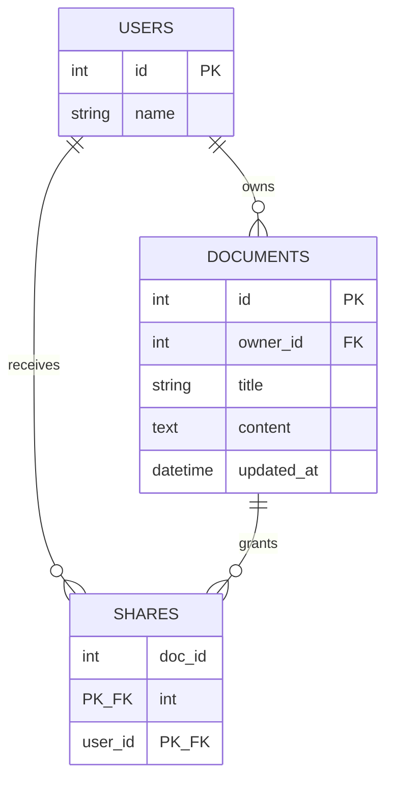

# SQLite data model

## Tables
- `users(id, name)` — two seeded users: 1 Alex and 2 Sam.
- `documents(id, owner_id, title, content, updated_at)` — document body is HTML string.
- `shares(doc_id, user_id)` — composite primary key prevents duplicate grants.

## Behavior
- Owner can read/edit/share; shared recipient can read/edit but cannot grant access.
- List query marks each document as `owned` or `shared`.
- SQLite persists locally across browser refreshes and local server restarts if the DB file is retained.
- Set DATABASE_PATH to a writable **persistent** filesystem location for server restart durability. Typical free ephemeral hosts cannot guarantee this.

## Schema creation
Tables are created automatically at first request using `init_db()` in app.py.
